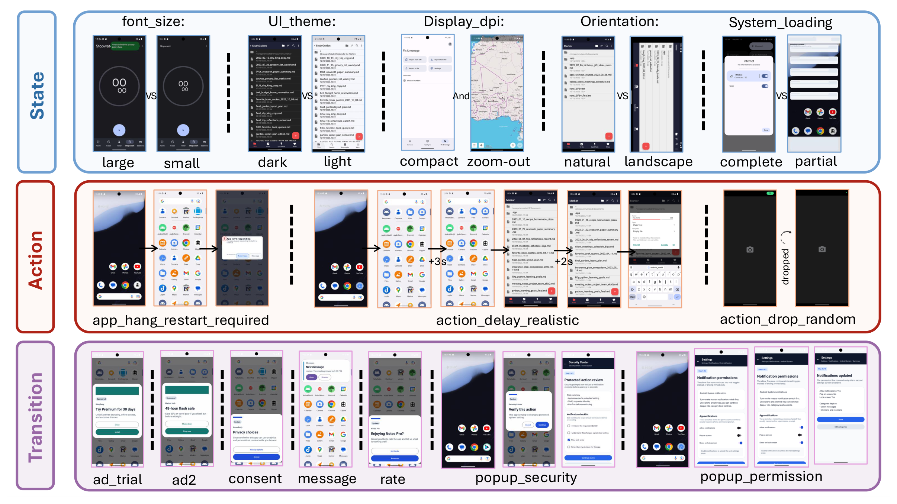
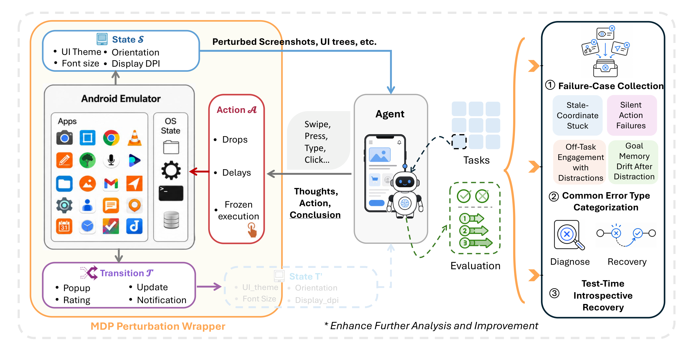
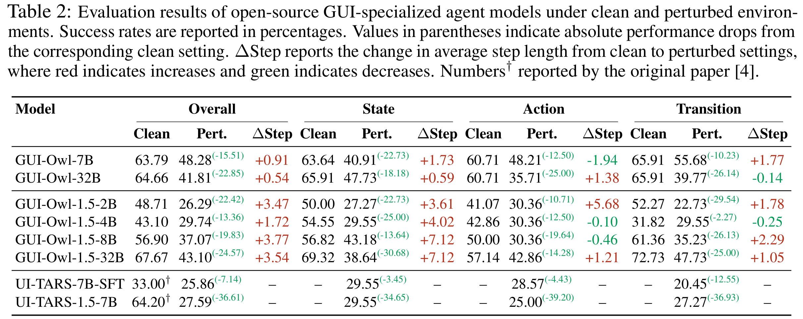

<div align="center">

# AndroidReality

### How Far Are Mobile Agents from the Real World?

**A perturbation-based benchmark and recovery toolkit for evaluating mobile GUI agents under realistic Android deployment conditions.**


</div>

<p align="center">
  
</p>

## Overview

AndroidReality is a robustness evaluation framework for mobile agents. It wraps the AndroidWorld interaction loop with realistic, controllable perturbations that mirror conditions agents encounter outside clean benchmark settings: changed font scale, dark theme, display-density shifts, landscape orientation, action delays, dropped actions, app hangs, pop-ups, ads, permission dialogs, update prompts, notifications, and more.

The benchmark is organized through an MDP lens:

- **State perturbations** alter the rendered observation surface, such as font size, UI theme, display DPI, orientation, locale/date formatting, and partial loading states.
- **Action perturbations** modify how intended actions are executed, including delayed actions, dropped actions, frozen execution, app hangs, and home-screen resets.
- **Transition perturbations** inject unexpected intermediate states, such as consent sheets, permission pop-ups, security dialogs, ads, rating prompts, app updates, and notifications.

AndroidReality also includes **Test-Time Introspective Recovery (TTIR)**, a training-free recovery layer that diagnoses stale coordinates, silent action failures, off-task distractions, and task-memory drift before issuing a targeted recovery action.

<p align="center">
  
</p>

## Highlights

- **MDP perturbation wrapper** for state, action, and transition-level robustness testing on top of AndroidWorld.
- **25 perturbation profiles** with fixed, reproducible defaults and per-run manifest logging.
- **Batch evaluation runner** that samples perturbation profiles per task and writes session-level logs, trajectories, manifests, and summaries.
- **Android helper app** for realistic interruption surfaces, including dialogs, bottom sheets, banners, and interstitial screens.
- **TTIR recovery module** with pre-action diagnosis, hard-stuck detection, recovery sessions, and JSONL traces for diagnosis/recovery behavior.
- **Post-hoc analysis tooling** for classifying failed trajectories and producing per-task Markdown reports.

## Artifact Status

| Component | Status | Notes |
| --- | --- | --- |
| MDP perturbation wrapper | Included | State, action, and transition perturbation environments. |
| Batch evaluation scripts | Included | Reproducible profile sampling with per-run manifests. |
| TTIR recovery module | Included | Diagnosis, recovery prompting, hard-stuck override, and JSONL traces. |
| Helper Android app | Included | Android Studio project for building and installing the helper APK. |
| Figures and result table | Included | High-resolution assets under `asset/`. |
| Model weights / API server | External | Use a GUI-Owl or OpenAI-compatible VLM endpoint. |
| AndroidWorld runtime | External | Expected to be installed in the evaluation environment. |

## Repository Layout

```text
.
|-- asset/
|   |-- androidreality_perturbation_examples.png
|   |-- androidreality_framework.png
|   `-- androidreality_results_table.png
|-- perturbation/
|   |-- run_ma3.py
|   |-- run_random_perturb_batch.py
|   |-- analyze_random_perturb_session.py
|   |-- run_ma3_random_perturb.sh
|   |-- mdp_perturbation/
|   `-- perturbation_helper_android_studio/
`-- recovery/
    |-- run_ma3.py
    |-- run_random_perturb_batch.py
    |-- run_ma3_random_perturb.sh
    `-- downstream_task/
```

## Requirements

This codebase is designed to run inside an AndroidWorld-compatible evaluation environment.

- Python environment with AndroidWorld and its dependencies available on `PYTHONPATH`.
- Android SDK, `adb`, and a running Android emulator.
- AndroidWorld gRPC environment on the configured port, by default `8554`.
- GUI-Owl or another OpenAI-compatible vision-language model endpoint.
- Java 17 if building the helper Android app from `perturbation/perturbation_helper_android_studio/`.

The runner auto-detects `adb` in common SDK locations. If needed, pass `--adb-path` or set the path in the shell wrapper.

## Quick Start

Start an Android emulator and confirm that it is visible:

```bash
adb devices
```

Run a perturbation-only evaluation:

```bash
cd perturbation

API_KEY=sk-local \
BASE_URL=http://127.0.0.1:4243/v1 \
MODEL=gui_owl_7b \
GUIOWL_VARIANT=7b \
TASKS=AudioRecorderRecordAudio \
REPEATS_PER_TASK=1 \
sh run_ma3_random_perturb.sh
```

Run a targeted subset of perturbations:

```bash
cd perturbation

PROFILE_NAMES=font_size_small,popup_security,action_drop_random \
TASKS=AudioRecorderRecordAudio \
REPEATS_PER_TASK=3 \
sh run_ma3_random_perturb.sh
```

Run with TTIR enabled:

```bash
cd recovery

DOWNSTREAM_PRE_ACTION_ENABLE=True \
DOWNSTREAM_PRE_ACTION_LOG_ENABLE=True \
DOWNSTREAM_PRE_ACTION_USE_RECOVERY_PROMPT=True \
DOWNSTREAM_HARD_STUCK_WINDOW=3 \
TASKS=AudioRecorderRecordAudio \
REPEATS_PER_TASK=1 \
sh run_ma3_random_perturb.sh
```

## Configuration

Common environment variables used by the shell runners:

| Variable | Default | Description |
| --- | --- | --- |
| `SUITE_FAMILY` | `android_world` | AndroidWorld task family. |
| `AGENT_NAME` | `gui_owl` | Agent implementation used by `run_ma3.py`. |
| `MODEL` | `gui_owl_7b` | Backend model name. |
| `BASE_URL` | `http://127.0.0.1:4243/v1` | OpenAI-compatible model endpoint. |
| `API_KEY` | `sk-local` | API key passed to the backend. |
| `TASKS` | empty | Comma-separated task names. |
| `TASKS_FILE` | empty | File containing one task name per line. |
| `PROFILE_NAMES` | all perturbations | Comma-separated perturbation profile subset. |
| `REPEATS_PER_TASK` | `1` | Number of sampled profiles per task. |
| `SAMPLING_SEED` | `20260427` | Reproducible profile sampling seed. |
| `GRPC_PORT` | `8554` | AndroidWorld gRPC port. |
| `CONSOLE_PORT` | `5554` | Emulator console port. |
| `SESSION_DIR` | timestamped session | Output directory for logs, trajectories, and summaries. |

Default perturbation strengths include `FONT_SIZE_LARGE_SCALE=1.35`, `FONT_SIZE_SMALL_SCALE=0.82`, `ACTION_DELAY_PROBABILITY=0.15`, `ACTION_DELAY_SECONDS=1.5`, and `ACTION_DROP_PROBABILITY=0.08`.

## Perturbation Profiles

| Family | Profiles |
| --- | --- |
| State / observation | `font_size_large`, `font_size_small`, `ui_theme_dark`, `display_size_dpi_compact`, `display_size_dpi_zoomed_out`, `orientation_landscape`, `locale_date_format_us12`, `locale_date_format_eu24`, `partial_loading_skeleton` |
| Action / execution | `execution_delay_loading`, `execution_delay_frozen`, `app_hang_restart_required`, `state_reset_home`, `action_delay_realistic`, `action_drop_random` |
| Transition / interruption | `bottom_sheet_consent`, `popup_permission`, `popup_security`, `interstitial_ad`, `ad_trial_offer`, `rate_dialog`, `update_system`, `update_app_sheet`, `notification_message`, `notification_delivery` |

Each batch run records the sampled profile, command-line flags, log path, and trajectory path in `manifest.jsonl`, making each perturbation assignment reproducible and auditable.

## Outputs

A run creates a timestamped session directory, for example `perturbation/random_perturb_runs/session_YYYYMMDD_HHMMSS/`, containing:

- `combined.log`: combined stdout/stderr for the full session.
- `manifest.jsonl`: one JSON record per task/profile run, including the exact command.
- `summary.json`: success extraction and profile-level aggregate metrics.
- `logs/`: per-run logs.
- `trajs/`: trajectory output roots.
- `android_world_runs/`: AndroidWorld run artifacts.

Analyze a completed perturbation session:

```bash
cd perturbation
python analyze_random_perturb_session.py \
  --session-dir random_perturb_runs/session_YYYYMMDD_HHMMSS
```

The analysis script writes `analysis/run_analysis.json`, `analysis/task_analysis.json`, and `analysis/analysis_report.md`.

## Reproducibility Notes

- Every batch session stores the exact command for each run in `manifest.jsonl`.
- `summary.json` records per-run success extraction, return codes, log paths, and trajectory roots.
- `SAMPLING_SEED` controls task-to-profile sampling for repeatable perturbation assignment.
- Perturbation defaults are centralized in `run_ma3_random_perturb.sh` and forwarded as explicit command-line flags.
- TTIR writes diagnosis and recovery traces as JSONL files when `DOWNSTREAM_PRE_ACTION_LOG_ENABLE=True`.

For a syntax-level sanity check that does not require launching an emulator:

```bash
python -m py_compile \
  perturbation/run_random_perturb_batch.py \
  perturbation/analyze_random_perturb_session.py \
  recovery/downstream_task/*.py
```

## Results

Across open-source GUI-specialized models, AndroidReality exposes large robustness gaps between clean AndroidWorld and perturbed AndroidReality settings. The paper reports overall success-rate drops from 13.36 to 36.61 percentage points, with transition and state perturbations causing especially large failures for several model families.

<p align="center">
  
</p>

## Test-Time Introspective Recovery

The recovery branch implements TTIR as a lightweight pre-action intervention layer. Before each normal GUI-Owl step, it asks a diagnosis module whether the current screen is healthy, whether the previous intended effect was satisfied, whether the agent is stuck, and whether a recovery action is needed.

TTIR supports:

- **Alternative-action recovery** for repeated stale-coordinate clicks and silent action failures.
- **Dismiss-interference recovery** for pop-ups, ads, update prompts, notifications, and other off-task overlays.
- **Wait recovery** for loading or temporarily unresponsive screens.
- **Backtrack / re-orientation recovery** when the agent drifts away from the original task context.
- **Hard-stuck override** when recent actions, thoughts, and summaries repeat over a fixed window.

When logging is enabled, TTIR writes `diagnosis.jsonl` and `recovery.jsonl` inside each task output directory.

## Helper Android App

The helper app in `perturbation/perturbation_helper_android_studio/` provides real Android interruption surfaces for benchmark-facing perturbations:

- Dialogs
- Bottom sheets
- Interstitials
- Banners

Open that folder directly in Android Studio, select Java 17, and build or install `app-debug.apk` on the emulator before running helper-interruption profiles.